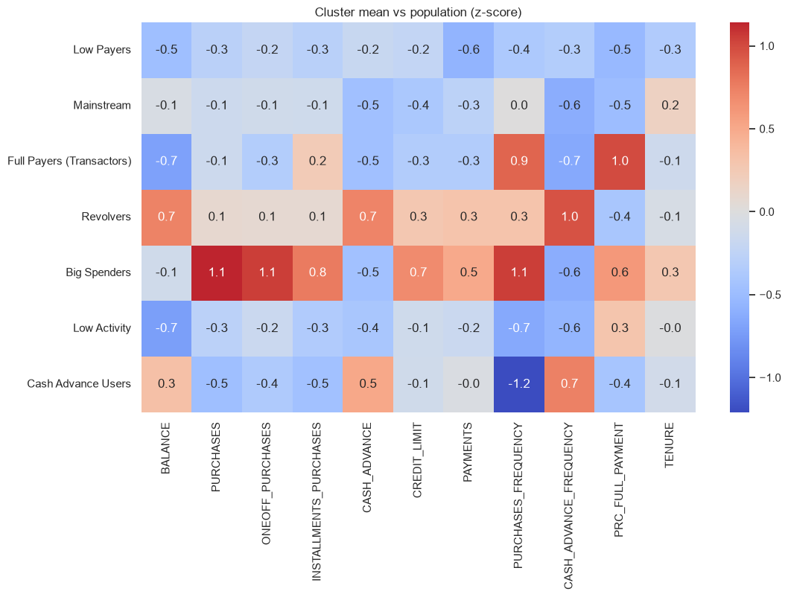
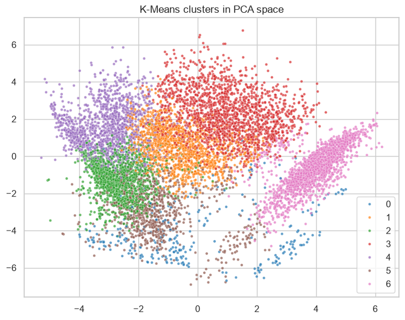
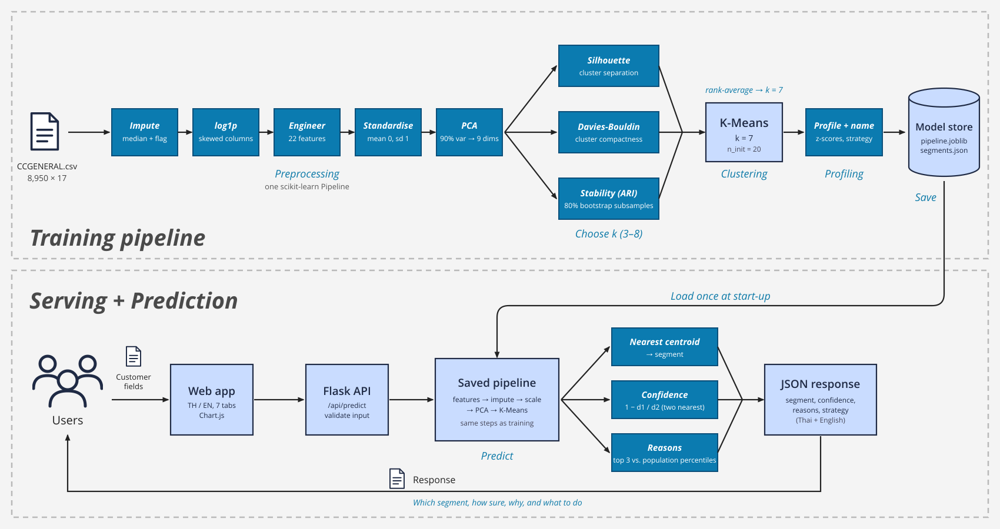

# Credit Card Customer Segmentation


Customer segmentation of ~9,000 credit card holders by how they used their card over 6 months, turned into a
web app that explains each segment, recommends a marketing strategy, and classifies new customers with a confidence
score and plain-language reasons.

The project covers the full path from EDA to a deployable service: feature engineering, model selection with honest
evaluation, segment profiling, a Flask API and dashboard, tests and Docker.

---

## Contents

- [Results](#results)
- [How it works](#how-it-works)
- [Why K-Means?](#why-k-means)
- [Web app](#web-app)
- [API](#api)
- [Quickstart](#quickstart)
- [Project structure](#project-structure)
- [Dataset](#dataset)
- [Limitations and responsible use](#limitations-and-responsible-use)
- [Acknowledgements](#acknowledgements)

---

## Results

**7 segments** were found. Each one gets a profile, distinctive traits and a recommended action:

| Segment | Share | Who they are | Recommended action |
|---|---:|---|---|
| Cash Advance Users | 22.3% | Hardly shop with the card but withdraw cash often, using it like a loan | Personal-loan / balance-transfer offers, lower cash-advance fees, monitor credit risk |
| Revolvers | 19.3% | High balance, cash advances plus purchases, rarely pay in full | Debt-consolidation offers, auto-pay reminders, watch default risk |
| Mainstream | 15.3% | Moderate use, rarely pay in full | Category-based offers, cross-sell, nudge towards instalment plans |
| Big Spenders | 15.0% | High spending and limits, buy often - the most valuable customers | Premium rewards, limit upgrades, focus on retention |
| Full Payers (Transactors) | 14.7% | Buy often, like instalments, often pay in full | Points and merchant partnerships, 0% instalment plans |
| Low Activity | 10.0% | Very low balance and purchases | Activation campaigns, starter-card benefits |
| Low Payers | 3.4% | Pay back very little relative to usage | Payment reminders, auto-pay enrolment, early collections |

**At a glance:** ~30% high-value customers to keep, ~45% to watch for credit risk, ~25% under-used and worth activating.

| Metric | Value | Meaning |
|---|---|---|
| Silhouette | 0.259 | Moderate separation - segments overlap at the borders |
| Davies-Bouldin | 1.35 | Lower is better |
| Bootstrap stability (ARI) | 0.98 | Re-clustering 80% subsamples gives almost the same segments |
| Hopkins (real vs shuffled data) | 0.875 vs 0.745 | Real cluster structure, but not well-separated blobs |

Because segments overlap, every prediction comes with a **confidence** score: about 63% of customers are clearly in one
segment, 21% fairly clearly, and 17% are borderline between two.

<table>
  <tr>
    <td></td>
    <td></td>
  </tr>
  <tr>
    <td align="center"><sub>What makes each segment different (z-score vs all customers)</sub></td>
    <td align="center"><sub>Customers on the first two PCA components</sub></td>
  </tr>
</table>

---

## How it works

<p align="center">
  
</p>

1. **Missing values** - `MINIMUM_PAYMENTS` (313 rows) and `CREDIT_LIMIT` (1 row) are filled with the median, plus a
   missing-flag (a missing minimum payment is informative). KNN imputation was tested and gave the same result.
2. **Skew** - money and count columns are extremely right-skewed, so `log1p` stops a few extreme spenders from driving
   the clusters.
3. **Feature engineering** - payment ratio, credit utilisation, average purchase size and average cash-advance size.
4. **PCA (90% variance, 22 -> 9 dims)** - removes redundancy and noise; it gave tighter clusters (Davies-Bouldin
   1.49 -> 1.35) and the most stable result.
5. **Choosing k** - silhouette alone is almost flat across k (0.24-0.26), so k is chosen by rank-averaging silhouette,
   Davies-Bouldin and bootstrap stability, excluding solutions with a segment under 2% (ties go to the higher silhouette).
6. **Naming** - each segment's means are compared with the population; rule-based names and Thai/English descriptions,
   traits and strategies are generated from those z-scores and should be reviewed by the business.
7. **Serving** - the same scikit-learn `Pipeline` (features -> impute -> scale -> PCA -> K-Means) is saved with joblib, so
   training and inference apply identical transformations.

All pipeline steps are inside one `sklearn.Pipeline`, and every UI number (examples, map, comparison table) is produced
at training time, so retraining refreshes the whole app.

---

## Why K-Means?

Four algorithms were compared on the same data with the same k (computed during training and shown in the app):

| Algorithm | Groups found | Silhouette | Stability (ARI) | Classifies new customers |
|---|---|---:|---:|---|
| **K-Means** (chosen) | 7 | **0.259** | **0.98** | Yes |
| Hierarchical (Ward) | 7 | 0.212 | 0.66 | No |
| Gaussian Mixture | 7 | 0.154 | 0.73 | Yes |
| DBSCAN | 2 + 19% noise | 0.204* | 0.52 | No |

<sub>*DBSCAN's score excludes the customers it discards as noise.</sub>

- **K-Means** has the best separation and is by far the most stable, which matters when campaigns run month after month.
- **Hierarchical clustering** is useful for exploration (dendrograms show which segments are related) but shifts a lot
  under resampling and has no `predict()`. Complete/average/single linkage just isolate single outliers.
  Ward-initialised K-Means gave no gain.
- **Feature variants** (dropping features, clipping outliers, extra share features, KNN imputation) brought no real
  improvement when judged in one common space.

**A note on comparing scores.** Some public notebooks on this dataset report a silhouette of ~0.41. They project to
2-D PCA and score the clusters inside that 2-D space. Scored in the same spaces, each approach wins only in its own space
(in ours: 0.23 vs 0.08; in theirs: 0.05 vs 0.18), so cross-setup silhouettes are not comparable. Likewise, a raw Hopkins
statistic of ~0.97 on unlogged data is not evidence of clusters: a column-shuffled copy scores ~0.95. This project
therefore reports Hopkins against a shuffled baseline. Details are in section 8 of the notebook.

---

## Web app

A Flask dashboard with seven tabs (available in Thai and English):

| Tab | What it shows |
|---|---|
| Overview | 3-line executive summary, how to read the page, segment sizes, customer map |
| Segments | One card per segment: share, description, traits, what to do, a typical real customer |
| Try a customer | One-click real examples or a short 8-field form; result with confidence, runner-up segment and reasons such as *"Cash advance: high (top 5% of customers)"* |
| Step by step | The 10-step method in plain language, with the real numbers |
| Why this method | Live algorithm comparison, why other scores look higher, why not deep learning, limitations, responsible use |
| FAQ & glossary | 10 common questions and 14 terms explained simply |
| Technical details | Metrics, API example, segment averages |

---

## API

```
GET  /health
GET  /api/segments
POST /api/predict
```

Send all 17 fields, or just the 8 essential ones with `"fill_missing": true` (the rest are estimated):

```bash
curl -X POST http://127.0.0.1:5000/api/predict \
  -H "Content-Type: application/json" \
  -d '{"fill_missing": true, "BALANCE": 3000, "CREDIT_LIMIT": 4000, "PURCHASES": 0,
       "PURCHASES_FREQUENCY": 0, "CASH_ADVANCE": 5000, "CASH_ADVANCE_FREQUENCY": 0.5,
       "PAYMENTS": 1500, "PRC_FULL_PAYMENT": 0}'
```

```json
{
  "results": [{
    "cluster": 6,
    "segment": "Cash Advance Users",
    "confidence": 0.285,
    "second_best_segment": "Revolvers",
    "reasons": [
      {"dir": "up",   "text_en": "Cash advance: high (top 5% of customers)"},
      {"dir": "up",   "text_en": "Cash advance frequency: high (top 5% of customers)"},
      {"dir": "down", "text_en": "Purchases: low (bottom 10% of customers)"}
    ],
    "strategy": "Use the card mainly as a cash line, not for shopping. Offer lower cash-advance fees, ..."
  }]
}
```

<sub>Trimmed. Batch requests use `{"customers": [{...}, {...}]}`. `MINIMUM_PAYMENTS` and `CREDIT_LIMIT` may be null; negative or
non-numeric values return HTTP 400.</sub>

---

## Quickstart

Requires Python 3.12.

```bash
git clone <your-repo-url>
cd Credit_Card_Dataset_for_Clustering

python -m venv .venv
# Windows: .venv\Scripts\activate    macOS/Linux: source .venv/bin/activate
pip install -r requirements-dev.txt   # runtime deps + notebook/plots/tests

python -m pytest           # 7 tests
python -m app.app          # http://127.0.0.1:5000
python -m src.train        # optional: retrain and rewrite models/ (auto-selects k; or --k 5)
```

The trained model in `models/` is committed and served as is. `requirements.txt` pins the exact library versions it was
trained with; if you change them, retrain and commit `models/` again.

**Notebook** - `notebooks/01_eda_and_clustering.ipynb` holds the EDA, k selection, algorithm comparison, stability
check, profiling and the hierarchical-clustering deep-dive. To re-execute it:

```bash
cd notebooks
jupyter nbconvert --to notebook --execute --inplace 01_eda_and_clustering.ipynb
```

**Docker** (gunicorn, non-root user, built-in health check on `/health`)

```bash
docker build -t cc-segmentation .
docker run -p 3010:3010 cc-segmentation     # http://127.0.0.1:3010
```

Optional environment variables: `PORT` (default 3010), `WEB_CONCURRENCY` (gunicorn workers, default 2).

**Deploy with Dokploy** - create an Application from this GitHub repo, set *Build Type* to **Dockerfile**
(path `Dockerfile`, context `.`), deploy, then add a domain with *Container Port* **3010**.

---

## Project structure

```
├── app/
│   ├── app.py                  Flask app: dashboard + JSON API
│   ├── static/                 Favicon (SVG, ICO, Apple touch icon)
│   └── templates/index.html    Single-page UI (Chart.js)
├── data/raw/CCGENERAL.csv      Dataset
├── notebooks/
│   └── 01_eda_and_clustering.ipynb
├── reports/figures/            Figures exported from the notebook
├── src/
│   ├── preprocess.py           Feature engineering + preprocessing pipeline (impute, log, scale, PCA)
│   ├── train.py                k selection, training, metrics, writes models/
│   ├── evaluation.py           Hopkins vs shuffled baseline, algorithm comparison
│   ├── segments.py             Profiling, rule-based naming, strategies
│   ├── labels.py               UI labels, segment descriptions, traits, algorithm texts
│   ├── ui_data.py              Example customers, map sample, percentiles for explanations
│   └── predict.py              Inference: segment, confidence, reasons, simple-mode filling
├── tests/                      Pipeline and prediction tests
├── models/                     Trained model served by the app (pipeline.joblib, segments.json)
├── Dockerfile
├── requirements.txt            Runtime dependencies (pinned)
└── requirements-dev.txt        + notebook, plotting and test tools
```

---

## Dataset

[Credit Card Dataset for Clustering](https://www.kaggle.com/datasets/arjunbhasin2013/ccdata) (Kaggle): usage behaviour of
about 9,000 active credit card holders over the last 6 months, one row per customer, 18 columns.

| Column | Description |
|---|---|
| `CUST_ID` | Card holder ID (not used for modelling) |
| `BALANCE` | Balance left in the account to make purchases |
| `BALANCE_FREQUENCY` | How often the balance is updated (0-1) |
| `PURCHASES` | Amount of purchases |
| `ONEOFF_PURCHASES` | Purchases made in one go |
| `INSTALLMENTS_PURCHASES` | Purchases made in instalments |
| `CASH_ADVANCE` | Cash advance taken |
| `PURCHASES_FREQUENCY` | How often purchases are made (0-1) |
| `ONEOFF_PURCHASES_FREQUENCY` | How often one-off purchases are made (0-1) |
| `PURCHASES_INSTALLMENTS_FREQUENCY` | How often instalment purchases are made (0-1) |
| `CASH_ADVANCE_FREQUENCY` | How often cash advances are taken (0-1) |
| `CASH_ADVANCE_TRX` | Number of cash-advance transactions |
| `PURCHASES_TRX` | Number of purchase transactions |
| `CREDIT_LIMIT` | Credit limit |
| `PAYMENTS` | Amount paid by the user |
| `MINIMUM_PAYMENTS` | Minimum payments made |
| `PRC_FULL_PAYMENT` | Share of full payments (0-1) |
| `TENURE` | Tenure of the card service, in months |

The currency is not stated; amounts are in the dataset's own units.

---

## Limitations and responsible use

- Segments overlap (silhouette ~0.26 for every k and method tried). Use the confidence score; better separation needs
  richer data such as merchant categories, channels or payment-delay history, not a different algorithm.
- This is a 6-month snapshot. Customers move between segments, so re-score regularly and rebuild every 3-6 months.
- Segments describe behaviour; they do not prove cause and effect. A/B test strategies before rolling them out.
- Segment names and the value / watch / grow grouping come from rules and should be reviewed by domain experts.
- Use segments to choose offers and messaging, **not** to approve or decline credit. That needs a validated credit-risk
  model. A "watch" segment is a prompt to offer help, not to penalise.

---

## Acknowledgements

- Dataset: [Arjun Bhasin, *Credit Card Dataset for Clustering*](https://www.kaggle.com/datasets/arjunbhasin2013/ccdata), Kaggle.
- The Hopkins test, dendrogram and per-cluster silhouette ideas, and several marketing ideas, were adapted after reviewing
  [*Credit Card Customer Clustering* by caesarmario](https://www.kaggle.com/caesarmario) on Kaggle. Its evaluation is
  re-examined in notebook section 8.
